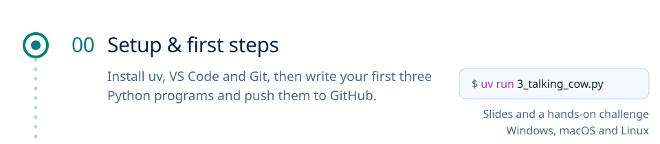
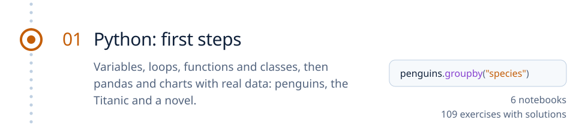
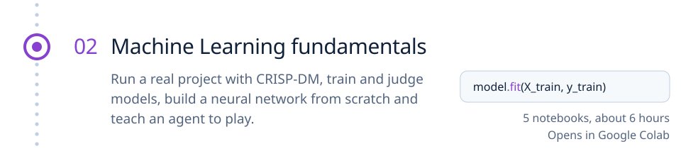
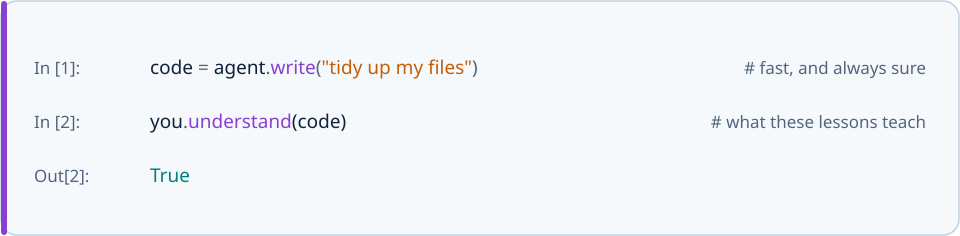

<div align="center">

<picture>
  <source media="(prefers-color-scheme: dark)" srcset="https://raw.githubusercontent.com/the-ai-learning-hub/.github/main/profile/assets/hero-dark.svg">
  
</picture>

<br>

**[Start with Lesson 00](https://github.com/the-ai-learning-hub/00-environment-setup)**&emsp;&emsp;[Open the slides](https://the-ai-learning-hub.github.io/00-environment-setup/)&emsp;&emsp;[Browse every lesson](https://github.com/orgs/the-ai-learning-hub/repositories)

</div>

<br>

## The path

Each lesson builds on the one before it. No programming background is needed to start, only curiosity and a computer. Click a lesson to open it.

<!-- The lessons below and the table after them are generated by scripts/build_profile_assets.py. Edit LESSONS there, not here. -->
<!-- path:start -->
<div>
<a href="https://github.com/the-ai-learning-hub/00-environment-setup"><picture><source media="(prefers-color-scheme: dark)" srcset="https://raw.githubusercontent.com/the-ai-learning-hub/.github/main/profile/assets/lesson-00-dark.svg"></picture></a>
<a href="https://github.com/the-ai-learning-hub/01-python-as-ai-first-steps"><picture><source media="(prefers-color-scheme: dark)" srcset="https://raw.githubusercontent.com/the-ai-learning-hub/.github/main/profile/assets/lesson-01-dark.svg"></picture></a>
<a href="https://github.com/the-ai-learning-hub/02-machine-learning-fundamentals"><picture><source media="(prefers-color-scheme: dark)" srcset="https://raw.githubusercontent.com/the-ai-learning-hub/.github/main/profile/assets/lesson-02-dark.svg"></picture></a>
<picture><source media="(prefers-color-scheme: dark)" srcset="https://raw.githubusercontent.com/the-ai-learning-hub/.github/main/profile/assets/lesson-next-dark.svg"></picture>
</div>
<!-- path:end -->

Every lesson has the same three parts: **slides** that explain one idea at a time in your browser, **notebooks** where you run every example yourself, and **exercises** with hidden solutions so you try first and check later.

<!-- table:start -->
| Lesson | Slides | Code and notebooks | Run without installing |
| :-- | :-: | :-: | :-: |
| **00** Setup & first steps | [Open](https://the-ai-learning-hub.github.io/00-environment-setup/) | [Repository](https://github.com/the-ai-learning-hub/00-environment-setup) |  |
| **01** Python: first steps | [Open](https://the-ai-learning-hub.github.io/01-python-as-ai-first-steps/) | [Repository](https://github.com/the-ai-learning-hub/01-python-as-ai-first-steps) |  |
| **02** Machine Learning fundamentals | [Open](https://the-ai-learning-hub.github.io/02-machine-learning-fundamentals/) | [Repository](https://github.com/the-ai-learning-hub/02-machine-learning-fundamentals) | [Google Colab](https://github.com/the-ai-learning-hub/02-machine-learning-fundamentals#o-percurso) |
<!-- table:end -->

<br>

## Why learn the basics if AI can write the code?

<picture>
  <source media="(prefers-color-scheme: dark)" srcset="https://raw.githubusercontent.com/the-ai-learning-hub/.github/main/profile/assets/notebook-dark.svg">
  
</picture>

An AI agent writes code fast and always sounds sure. But that code runs on **your** computer, with **your** files and **your** data. One wrong line can delete a database, overwrite yesterday's spreadsheet, or quietly return an answer that looks right and isn't.

You don't need to write every line yourself. You need to understand every line you run. These are the questions to ask before you press Enter, and where you learn to answer them:

| Before you press Enter, ask… | You learn it in |
| :-- | :-- |
| What does it do? | [01 · Basics](https://the-ai-learning-hub.github.io/01-python-as-ai-first-steps/#basics) |
| What data does it touch? | [01 · Data structures](https://the-ai-learning-hub.github.io/01-python-as-ai-first-steps/#data-structures) and [Pandas](https://the-ai-learning-hub.github.io/01-python-as-ai-first-steps/#pandas) |
| Can it delete or overwrite something? | [01 · Files and visualization](https://the-ai-learning-hub.github.io/01-python-as-ai-first-steps/#visualization) |
| How long will it run? | [01 · Loops](https://the-ai-learning-hub.github.io/01-python-as-ai-first-steps/#loops) |
| What happens if it fails? | [01 · Modules, errors and classes](https://the-ai-learning-hub.github.io/01-python-as-ai-first-steps/#reuse) |
| Is the model's answer any good? | [02 · Metrics](https://the-ai-learning-hub.github.io/02-machine-learning-fundamentals/#metricas) |

<br>

## Start in a minute

Install [uv](https://docs.astral.sh/uv/), the tool that installs Python and every library a lesson needs. Lesson 00 walks through this step by step.

```bash
# Windows (PowerShell)
powershell -ExecutionPolicy ByPass -c "irm https://astral.sh/uv/install.ps1 | iex"

# macOS and Linux
curl -LsSf https://astral.sh/uv/install.sh | sh
```

Then pick a lesson, install what it needs and open it in VS Code:

```bash
git clone https://github.com/the-ai-learning-hub/01-python-as-ai-first-steps.git
cd 01-python-as-ai-first-steps
uv sync
code .
```

<br>

## Help make it better

- **Found a typo, a broken link or a slide that confused you?** Open an issue in that lesson's repository. If it confused you, it will confuse someone else.
- **Have a clearer explanation or a better exercise?** Pull requests are welcome.
- **Speak another language?** Slides are in English; some notebooks and Lesson 02 are in Portuguese. Translations help the next learner.
- **Found a lesson useful?** Star its repository so others can find it.

<br>

<div align="center">
<sub>Every lesson is free and released under the <a href="https://github.com/the-ai-learning-hub/.github/blob/main/LICENSE">MIT License</a>. Typefaces: Bricolage Grotesque and JetBrains Mono (SIL OFL).</sub>
</div>
